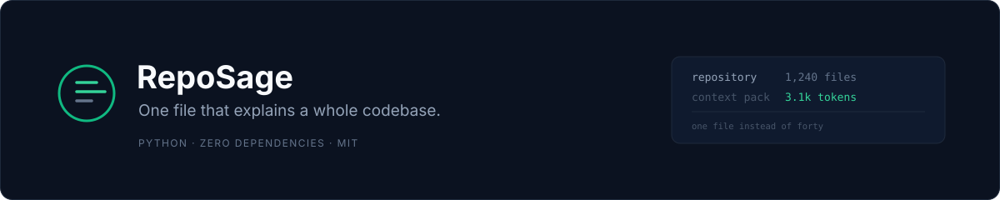

<p align="center">
  
</p>

**Generate a compressed, AI-ready "context pack" for any codebase** — architecture, HTTP endpoints, dependencies, TODOs, security notes and conventions — in Markdown, JSON, or a paste-ready AI prompt. Incremental updates. Zero dependencies.

  

## The problem

AI agents and LLMs are bad at unfamiliar codebases. You either waste tokens pasting dozens of files or the model guesses. RepoSage distills an entire repository into one structured, token-efficient document that a human or an AI can consume in seconds.

## Features

- **7 plug-in analyzers** — overview, structure, endpoints, dependencies, TODOs, security, conventions
- **20+ frameworks detected** — Flask, FastAPI, Django, Express, NestJS, Gin/Echo, Spring, Rails, Laravel, ASP.NET, Axum, Ktor and more
- **Security scanning** — hardcoded secrets (AWS/GitHub/Slack/Stripe/OpenAI keys, JWTs, private keys), risky calls (`eval`, `shell=True`, `pickle`), and committed `.env` files
- **Incremental updates** — `reposage update` re-analyzes only changed files (git-aware), with a content-hash fallback for non-git directories
- **3 output formats** — Markdown, JSON, and a paste-ready AI prompt (`reposage prompt`)
- **CI mode** — `reposage check` exits non-zero when secrets are found; drop it in a GitHub Action as a poor-man's secret scanner
- **Zero runtime dependencies** — pure Python standard library, works on Python 3.9+
- **Respects your ignores** — `.gitignore`, `.reposageignore`, plus sane defaults (`node_modules`, `venv`, build dirs...)
- **Resource-bounded** — configurable file size, file count, depth and a total read budget, so huge repos never hang

## Requirements

- Python **3.9 or higher** (3.11+ recommended; 3.9–3.10 use a built-in TOML fallback parser)
- Git *optional* — used for repo metadata, git-aware incremental updates and `.env` tracking detection
- No third-party packages. Ever.

## Installation

```bash
# Option A: run from the source tree, no install needed
python -m reposage --help

# Option B: install as a command
pip install .

# Option C: install in editable/dev mode
pip install -e .
```

After installing, the `reposage` command is available on your PATH.

## Quickstart

```bash
cd your-project

reposage init            # optional: create .reposage.toml (works without it)
reposage generate        # scan and write reposage-out/reposage.md + reposage.json
reposage brief           # print a one-page summary to the terminal
reposage prompt          # print the pack wrapped in a paste-ready AI prompt
reposage update          # incremental refresh (only changed files re-analyzed)
reposage check           # security scan, exit 1 if secrets found (CI mode)
```

## Commands

| Command | Description |
|---|---|
| `reposage init [path]` | Write a default `.reposage.toml` config (`--force` to overwrite) |
| `reposage generate [path]` | Full scan; writes `reposage-out/reposage.md` and `reposage.json` |
| `reposage update [path]` | Incremental refresh using git status or content hashes; `--force` = full rescan |
| `reposage brief [path]` | One-page summary to stdout |
| `reposage prompt [path]` | Full pack wrapped in a paste-ready AI prompt (`--out FILE` to save) |
| `reposage check [path]` | Security-only scan; exit 1 on secrets, `--strict` also fails on risky calls |

Common flags: `--out-dir DIR` (override output directory), `--format md|json|both`, `-q/--quiet`.

## Configuration (`.reposage.toml`)

```toml
[general]
name = ""                # display name (defaults to repo/dir name)
out_dir = "reposage-out" # output directory
max_depth = 24           # max directory depth to scan
max_files = 3000         # max files to scan
max_file_kb = 500        # skip files larger than this (KB)
read_budget_mb = 100     # total content budget for reading files (MB)

[plugins]
enabled = ["overview", "structure", "endpoints", "dependencies", "todos", "security", "conventions"]

[ignore]
extra = []               # additional ignore patterns (gitignore syntax)
```

Ignore precedence: built-in defaults < `.gitignore` < `.reposageignore` < `[ignore] extra` (later rules win, `!` negation supported).

## Output example

```markdown
# RepoSage Context Pack - my-api

## Overview
| Name       | my-api                        |
| Git        | github.com/me/my-api (main @ a1b2c3d) |
| Size       | 12,340 LOC across 512 files   |
| Languages  | Python 68%, TypeScript 21%    |

## Endpoints
| Method | Path            | File:Line          |
|--------|-----------------|--------------------|
| GET    | `/api/users`    | src/api/users.py:14|
| POST   | `/api/users/:id`| src/server.ts:42   |

## Security Notes
- **[HIGH]** src/config.py:7 - AWS access key ID
- [LOW] src/util.py:12 - subprocess with shell=True
```

See [examples/example-output.md](examples/example-output.md) for a real pack generated by RepoSage on its own source.

## CI integration

`reposage check` is designed for pipelines. Exit codes: `0` clean, `1` secrets (or risky calls with `--strict`) found, `2` error.

```yaml
# .github/workflows/secret-scan.yml
name: Secret scan
on: [push, pull_request]
jobs:
  scan:
    runs-on: ubuntu-latest
    steps:
      - uses: actions/checkout@v4
      - uses: actions/setup-python@v5
        with: { python-version: "3.12" }
      - run: pip install .
      - run: reposage check .
```

## Using the pack with AI agents

1. Run `reposage generate` in your repo.
2. Paste `reposage-out/reposage.md` into any LLM chat, or use `reposage prompt` which wraps it in a system-prompt template ("cite file paths, don't guess").
3. Ask questions: *"Where is authentication handled?", "What does the `/api/upload` endpoint do?", "Which TODO items are riskiest?"*

RepoSage also ships as a **Qoder Skill** — see [skill/SKILL.md](skill/SKILL.md).

## How the security scanner works (and its limits)

RepoSage uses high-precision regex patterns for well-known credential formats plus heuristics for generic `password = "..."` assignments (placeholder-aware: `your_key_here`, `$ENV`, `os.environ` lookups are skipped). It is **not** a substitute for gitleaks/trufflehog/CodeQL — it catches the common cases cheaply, with zero dependencies, inside a context pack. No entropy analysis, no vendor verification of matches.

## FAQ

**Large repos?** Defaults cap at 3,000 files / 100 MB of content; raise limits in `.reposage.toml`. The walker prunes ignored directories, so `node_modules` is never touched.

**Monorepos?** Workspaces are detected (`pnpm-workspace.yaml`, `nx.json`, `turbo.json`...) and every manifest type is parsed per package. Scans whole tree by default.

**Accuracy?** Endpoint extraction is regex-based and may miss dynamically-built routes; treat the pack as a map, not ground truth — it always cites `file:line` so you can verify.

## Development

```bash
python -m unittest discover -v   # run the 36-test suite
python -m reposage generate .    # dogfood: RepoSage scans itself
```

CI runs the suite on Python 3.9 / 3.11 / 3.13 across Ubuntu and Windows.

## Contributing

Issues and PRs welcome. Add a framework to `reposage/analyzers/endpoints.py` (a regex + an extension mapping), a manifest type to `dependencies.py`, or a secret pattern to `security.py` — each is a self-contained change with a matching test in `tests/test_analyzers.py`.

## License

MIT — see [LICENSE](LICENSE).
